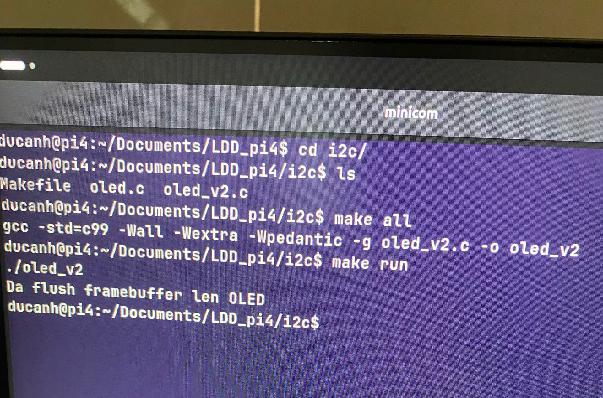
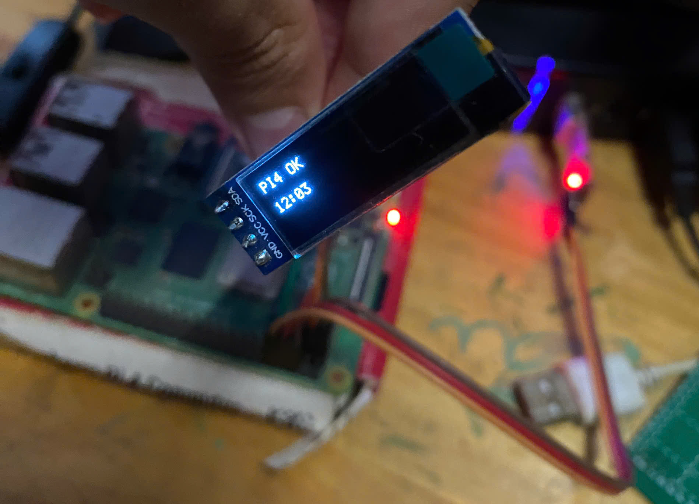

# Điều khiển màn hình OLED SSD1306 bằng I2C


## Bài tập này làm gì?

Đây là chương trình C chạy ở user space trên Linux, dùng giao diện
`/dev/i2c-1` để gửi lệnh và dữ liệu đến màn hình OLED SSD1306 qua I2C.


Mục đích:

- hiểu cách mở I2C device bằng `open()`;
- chọn địa chỉ slave bằng `ioctl(..., I2C_SLAVE, 0x3C)`;
- gửi lệnh SSD1306 bằng `write()`;
- tạo framebuffer 128 x 32 pixel trong RAM;
- vẽ chữ đơn giản rồi gửi framebuffer lên màn hình.

Đây là bài học user space, chưa phải kernel driver hoàn chỉnh.

## Kết nối phần cứng

Phần mã nguồn hiện tại được viết cho module SSD1306 **128 x 32**, địa chỉ I2C
7-bit mặc định là `0x3C`.

| OLED | Raspberry Pi 4 |
|---|---|
| VCC | 3.3 V, chân 1 |
| GND | GND, chân 6 |
| SDA | GPIO2, chân 3 |
| SCL | GPIO3, chân 5 |


Kiểm tra I2C trên Raspberry Pi:

```sh
uname -a
i2cdetect -l
i2cdetect -y 1
ls -l /dev/i2c-1
```

## Build và chạy

```sh
make
./oled_v2
```

Dọn file build:

```sh
make clean
```

## Luồng hoạt động của `oled_v2.c`

Chương trình thực hiện các bước sau:

1. Mở `/dev/i2c-1` bằng `open()`.
2. Chọn slave address `0x3C` bằng `I2C_SLAVE`.
3. Gửi chuỗi lệnh khởi tạo SSD1306.
4. Đặt cửa sổ ghi RAM từ cột 0 đến 127 và page 0 đến 3.
5. Gửi 512 byte framebuffer, chia thành các gói 16 byte.
6. Vẽ chuỗi `PI4 OK` và `12:03` lên framebuffer.
7. Đóng file descriptor.

### Control byte I2C

Mỗi payload bắt đầu bằng một control byte:

- `0x00`: phần còn lại là command SSD1306;
- `0x40`: phần còn lại là dữ liệu pixel.

Địa chỉ `0x3C` là địa chỉ 7-bit. Không thay nó bằng byte địa chỉ ghi `0x78`
trong lời gọi `I2C_SLAVE`.

### Framebuffer

Màn hình 128 x 32 có 4 page, mỗi page chứa 128 byte, tổng cộng 512 byte.
Mỗi byte biểu diễn 8 pixel theo chiều dọc:

```text
page = y / 8
bit  = y % 8
index = page * 128 + x
mask = 1 << bit
```

Hàm vẽ chỉ thay đổi bộ nhớ trong chương trình. Hình chỉ xuất hiện trên OLED
sau khi `oled_flush()` gửi toàn bộ framebuffer qua I2C.


## Kết quả demo trên Pi4




## Tài liệu tham khảo

- [Linux I2C userspace interface](https://docs.kernel.org/i2c/dev-interface.html)
- [SSD1306 datasheet](https://www.sunrom.com/download/SSD1306.pdf)
- Các ảnh và video thử nghiệm nằm trong thư mục `img_test/`.

